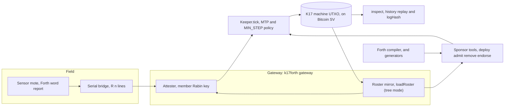
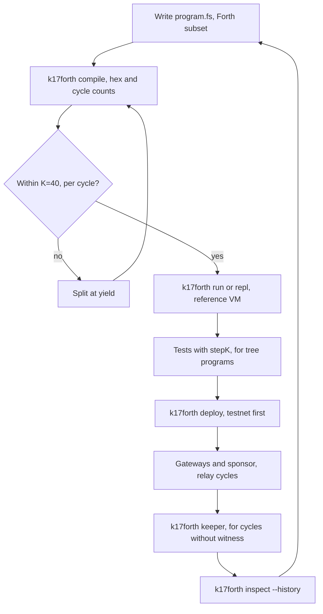
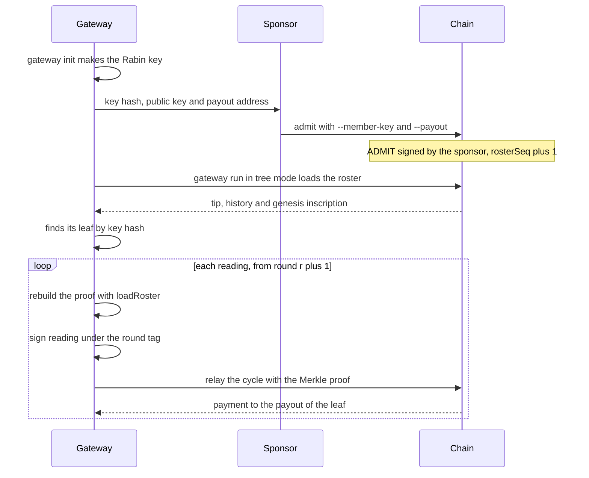
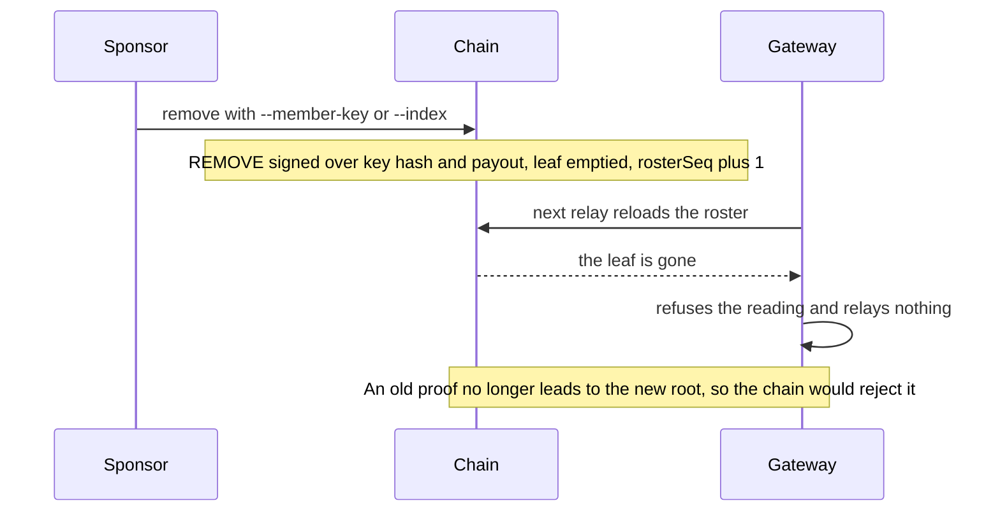
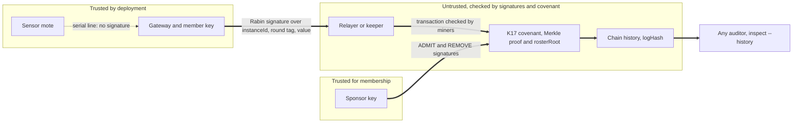

# Architecture

This document explains four things. First, how `k17-dc4cd` is built. Second, how you write and run your own machine with it. Third, how gateways join and leave a machine. Fourth, what the chain gives a DC4CD-style sensor network that a plain radio network does not give.

The text describes the code at the commit that added this file. Every claim about the contract comes from `../k17-vm` (public: https://github.com/Bittoku/k17-vm). This repository is public at https://github.com/Bittoku/k17-dc4cd.

## 1. What this repository adds to K17

K17 is a stack machine that runs inside a Bitcoin SV covenant. One UTXO is one suspended process. Any party can spend the UTXO to run the next K instructions (K = 40). The contract accepts the spend only if the next UTXO holds the same program and the correct next state. `../k17-vm` holds the contract and the reference VM.

This repository adds three things to K17:

- a compiler for a Forth subset (`src/forth/`). With it, you write a K17 program as Forth source.
- program generators (`src/programs/`) for sensor consortiums: a relay, a fuzzy fire-detection demo, a slot-mode consortium and a tree-mode consortium.
- chain tooling, the `k17forth` command (`src/cli/`, `src/chain/`, `src/gateway/`). It deploys a machine and keeps it running. It lets gateways relay signed sensor readings. It lets a sponsor manage the members. It audits the history.

With these parts, a DC4CD-style network can settle on Bitcoin SV. DC4CD (Gaglio, Lo Re, Martorella and Peri, ACM TECS 2017) is an active sensor network. Its motes run Forth and send Forth code to each other with `tell:`. Here the motes keep their Forth. A gateway turns each reading into a signed message. The chain checks the signature, pays the sensor owner and records the reading.

## 2. System components



The list below gives one entry for each component.

- **Sensor mote and bridge.** The mote runs the Forth words `>gateway` and `report`. It prints one line `R <reading>` on a serial line (`docs/bridge-mote.fs`). `openBridge` in `src/gateway/bridge.ts` reads those lines from a serial device or from standard input. It ignores every other line.
- **Gateway.** `k17forth gateway run` (`src/cli/gateway.ts`, `src/gateway/gateway.ts`) takes each reading and checks the round. It signs the reading and gives it to the keeper.
- **Attester.** `MemberAttester` (tree mode) and `GatewayAttester` (slot mode) in `src/gateway/attester.ts` hold the Rabin key of the member. They sign the reading. They refuse each reading that the chain would reject: no round open, round closed, reading out of range (unless `sign_anyway` is set), and, for `GatewayAttester`, a slot that does not hold its key. In tree mode the gateway checks roster membership before every relay.
- **Roster mirror.** `loadRoster` (`src/chain/loadRoster.ts`) rebuilds the Merkle roster from the genesis inscription and a replay of the whole machine history (`RosterMirror` in `src/chain/roster.ts`). It checks the result against the root and the sequence number at the tip. It is the only source of Merkle proofs.
- **Keeper.** `Keeper.tick` (`src/chain/keeper.ts`) loads the machine and picks the lock time min(now, MTP - 1). It plans the cycle with `planCycle` from `k17-vm` and broadcasts the cycle. The chain clock must move 60 seconds past the last cycle (`MIN_STEP`). If it did not, the tick reports `waiting for MTP` and sends nothing.
- **K17 machine UTXO.** The covenant from `../k17-vm`. It checks every cycle: the signature, the Merkle proof, the payment and the next state.
- **Sponsor tools.** `deploy` (`src/cli/deploy.ts`) deploys the machine. With `--tree`, it also publishes the genesis roster as a 1Sat inscription through `src/chain/inscription.ts`. For tree mode, `inscribe-genesis`, `admit` and `remove` (`src/cli/admit.ts`) are also available. For slot mode, `endorse` (`src/cli/endorse.ts`) is available.
- **inspect.** `src/cli/inspect.ts` and `src/chain/history.ts` walk the machine back to its deployment. They replay every cycle and check the log hash exactly.
- **Compiler and generators.** `src/forth/compiler.ts` compiles Forth to K17 bytecode. `src/programs/{relay,fuzzy,consortium,treeConsortium}.ts` generate Forth source for the sensor programs.

The `keeper` command is a plain keeper. It does not relay tree-mode cycles that need a Merkle proof (a reading, `admit` or `remove`). On such a machine it prints `skipped: needs witness` and sends nothing. It still halts the machine at its end time or by the dead-man. Gateways and the sponsor tools relay those cycles.

## 3. Implementing your own machine

### The development loop



### Step 1: write the program

A program is Forth source. A comment starts with `\` or sits in `( ... )`. A number is decimal, or hexadecimal with a `$` prefix. The compiler is `src/forth/compiler.ts`. It supports these words:

- **Definitions:** `: name ... ;`, `variable name`, `value constant name`.
- **Control:** `if else then`, `begin until`, `begin again`, `begin while repeat`. K17 `IF` jumps when the top of the stack is zero. Therefore `if ... then` runs its body when the value is not zero.
- **Stack and arithmetic:** `dup drop swap over >r r> + - * / and or xor 0= min max`. `/` is unsigned integer division. It faults on a zero divisor. `min` and `max` are the fuzzy AND and OR.
- **Memory:** `@` and `!`. Cells from `roster-base` up are write-protected. The constants `roster-base`, `slot-cells`, `roster-slots`, `mem-cells` and `out-max` are built in.
- **Machine:** `halt` (stop and refund the remaining balance to the beneficiary), `yield` (end this cycle now), `time` (the lock time of the cycle), `in` (next witness cell), `verify` (the transaction is invalid when the value is zero), `out` (append to the output log), `hash`, `who`, `value`, `exit`.
- **Bounty and signatures, with a literal operand written before the word:** `150 bounty` releases 150 satoshis to the spender. `0 sigverify` checks a Rabin signature under roster slot 0 (`TAG VAL sigverify`).
- **Slot-mode roster words:** `attest` (`TAG VAL SLOT --`), `endorse` (`TAG SLOT NEWSLOT --`), `payslot` (`N SLOT --`).
- **Tree-roster words** (stack effects from the `../k17-vm` README, "Tree roster"):

| Word        | Stack effect   | Meaning                                                                                                                                            |
| ----------- | -------------- | -------------------------------------------------------------------------------------------------------------------------------------------------- |
| `member`    | `-- IDX`       | Check the Merkle proof against the roster root and bind that member for the cycle.                                                                 |
| `lastround` | `-- R`         | Push the `lastRound` of the bound member.                                                                                                          |
| `attestm`   | `TAG VAL --`   | Check a reading signed by the key of the bound member.                                                                                             |
| `payleaf`   | `N ROUND --`   | Pay `N` satoshis to the bound member and set its `lastRound` to `ROUND`. `ROUND` must be above the old `lastRound`, or the transaction is invalid. |
| `admit`     | `TAG ROUND --` | The sponsor puts a new member into an empty leaf with `lastRound` = `ROUND`.                                                                       |
| `remove`    | `TAG --`       | The sponsor empties an occupied leaf.                                                                                                              |
| `outh`      | `N --`         | Fold `N` into the log hash.                                                                                                                        |

The compiler places top-level code first, then `HALT`, then the colon definitions.

### Step 2: compile

```bash
k17forth compile program.fs
```

The command prints the hex, the disassembly and `cycles: ...`, the instruction count of each cycle. The count goes through the source in a straight line. It ends a cycle at each `yield`. It does not follow calls. The compiler places colon definitions after the final `halt`, so the count shows their bodies once, in the last cycle. The count is exact only for a program with no branches and no calls. For the relay it prints 18 for each hop. The real hop is 36 (18 plus the 18 instructions of `accumulate`). For a program with branches (the tree consortium), the count adds the branches together, so it is an upper bound. The real limit is the longest path through each cycle. `tests/treeConsortium.test.ts` checks that path (`longestBranches`).

### Step 3: try it on the reference VM

```bash
k17forth run program.fs --scenario scenario.json   # one cycle per scenario entry
k17forth repl program.fs                           # one line at a time
```

A scenario (`src/cli/scenario.ts`) lists cycles. Each cycle has a `lockTime` and the `witness` cells for `in`. It can also have `sigverify`, `attest` and `endorse` entries that name a seeded attester. Scenarios and the repl do not cover the tree words. For a tree program, write a mocha test with `stepK` and `SparseMerkleTree` from `k17-vm`, as `tests/treeConsortium.test.ts` does.

### Step 4: respect the K = 40 budget

Every cycle runs at most 40 instructions. If a stage is longer, put a `yield` in the middle. The stage then becomes two transactions. Do not raise K. The relay does this: each hop is 36 instructions and ends in `yield`. The tree consortium keeps every branch inside 40. The reading branch is at most 36 instructions with a range check. It is 34 when the range starts at 0, as in the example below. Without a range check it is 30.

### A worked program: the relay

The relay (`src/programs/relay.ts`, DC4CD section 5.1) is the smallest complete program in the repository. Each hop reads a signed reading, pays a bounty and ends its cycle. This is the source of `examples/relay.fs`:

```forth
variable sum
variable lo
variable hi

: accumulate ( reading -- )
  dup sum @ + sum !
  dup lo @ min lo !
  hi @ max hi ! ;

$ffffffff lo !          \ running minimum starts at the top of the range
yield                   \ deployment cycle ends here; hop 0 is the next transaction

\ ---- hop 0: roster slot 0 attests (tag 268451456, reading)
time 1760604800 - $80000000 and 0= if halt then   \ past the deadline: refund
268451456 in over over 0 sigverify swap drop  \ ( reading )
150 bounty
accumulate
yield
```

Read the hop from top to bottom. The line with `time` halts and refunds when the lock time is past the deadline. The next line pushes the tag and reads the reading from the witness (`in`). It copies both and checks the signature of roster slot 0 (`sigverify` takes `TAG VAL`). Then it drops the tag. `150 bounty` pays the party that relays the cycle. `accumulate` updates the sum, the minimum and the maximum. `yield` ends the cycle.

### A worked program: the tree consortium

`treeConsortiumSource` in `src/programs/treeConsortium.ts` generates the program for a roster machine. This is its output for `start = 1792390000`, `period = 86400`, `rounds = 30`, `bountyPerReading = 200` and `range = 0..10000`:

```forth
begin
  \ cycle start (the first cycle, or the 'until' jump after a YIELD)
  time 1794982000 / if halt then  \ TIME >= END: halt and refund, before any IN
  in  ( sel )
  dup if
    \ ---- admin: sel 1 admits, sel 2 removes, any other value is refused
    1 - dup if  ( sel-1 )
      1 - dup if 0 verify then  ( 0 )  \ sel must be 2
      1275068416 remove  ( 0 )  \ sponsor-signed removal under REMOVE_TAG
    else  ( 0 )
      1207959552  ( 0 tag )
      time 1792390000 / dup if  \ TIME >= start: round from TIME, else round 0
        drop time 1792303600 - 86400 /
      then  ( 0 tag round )
      admit  ( 0 )  \ sponsor-signed admission with lastRound := round
    then
  else
    \ ---- reading ( 0 )
    time 1792390000 / verify  \ TIME >= start (rounds start at 1)
    200 time 1792303600 - 86400 /  ( 0 bounty round )
    member drop  \ verify the proof, bind the member; the leaf index is unused
    dup 1073741824 + in  ( 0 bounty round tag reading )
    dup 10001 / if 0 verify then  \ 0 <= reading <= 10000
    swap over attestm  ( 0 bounty round reading )  \ signed by the member under readingTag(round)
    outh  ( 0 bounty round )  \ fold the reading into the log hash
    payleaf  ( 0 )  \ pay the bounty, lastRound := round
  then
  yield
until  \ the selector, now 0 on every branch: jump back to begin
```

The generator also writes four comment lines at the top. This listing leaves them out.

Every cycle starts the same way. The program halts when the time is at or past the end. Otherwise it reads a selector from the witness. The selector 0 is a reading, 1 is an admission and 2 is a removal. Any other value fails `verify`, and the transaction is invalid. The round comes from `time`, never from the witness. The comparison `X D / if 0 verify then` is the cheap form of `X < D`. For `D > 0`, the quotient is zero exactly when `X < D`.

### Step 5: deploy

Use testnet first. The examples call the tool `k17forth`. Without `npm link`, use `npm run k17forth --` in its place. This is a slot-mode machine:

```bash
k17forth deploy consortium.fs --config sponsor.toml --deposit 50000 \
  --reward-min 100 --slope 1 --reward-max 500 \
  --sponsor <sponsor key hash> --dead-man 2592000
```

A tree-mode machine adds the member list:

```bash
k17forth deploy tree.fs --config sponsor.toml --deposit 100000 \
  --reward-min 100 --slope 1 --reward-max 500 \
  --tree members.json --sponsor <sponsor key hash> --dead-man 2592000
```

`--tree` needs `--sponsor`. The command deploys the machine with the root of the member list. It publishes the list as a 1Sat inscription. It writes `outpoint`, `genesis_outpoint` and `genesis_inscription` into `[machine]` of the config. `--dead-man <seconds>` sets an immutable refund timer. If no cycle ran for that time, any keeper can halt the machine and refund the deposit. The value is 0 (off) or at least 21600 (6 hours). Use 30 days for daily rounds. The tutorial (`docs/tutorial-dc4cd-gateway.md`) shows every step with real output.

### Step 6: keep it alive

```bash
k17forth keeper --config sponsor.toml --interval 60
```

The keeper runs the cycles that need no witness. It opens and closes rounds, and it halts the machine at the end. Any party can run a keeper. The machine pays the keeper a reward that grows with the waiting time. A tree machine needs a witness for every reading, admission and removal. On such a machine, the gateways and the sponsor tools do the relaying (see section 2).

### Step 7: inspect

```bash
k17forth inspect <tip outpoint> --history --config sponsor.toml
```

`inspect` prints the machine state. With `--history`, it also prints every cycle back to the deployment. On a tree machine it also prints the roster, every paid reading, every admission and every removal. It ends with `logHash: verified`, `mismatch` or `not checked`.

## 4. How workers (gateways) join and leave

A worker is a sensor owner with a gateway. Its identity on the chain is a Rabin key. The machine keeps the list of keys in one of two ways.

**Slot mode** (`src/programs/consortium.ts`). The roster is eight slots in the machine memory. Slot 0 holds the sponsor. The sponsor key is in the deployment. A new member enters a free slot when an existing member vouches for it. The member signs an `ENDORSE` message for the new key, the payout and the slot, and the contract writes the slot. The consortium program has the sponsor endorse each landowner, in slot order, one cycle each, up to `enrolDeadline`. The roster is limited to seven landowners, and it ends at the enrolment deadline.

**Tree mode** (`src/programs/treeConsortium.ts`). The roster is a sparse Merkle tree with 65 536 leaves. The machine holds only the root and a sequence number (`rosterSeq`). A leaf holds the `keyHash` of the Rabin key of the member and the `payout` (a 20-byte address hash). It also holds `lastRound`, the last round for which the member was paid, and a reserved `flags` cell. The sponsor admits and removes members at any time with `ADMIT` and `REMOVE`. Each of these signatures covers `rosterSeq`, and each operation adds 1 to it. So a signature is valid for one operation only. Nobody can replay an old admission after a removal.

Tree mode has three rules:

- A genesis member has the `lastRound` given in `members.json` (normally 0). When it is 0, the member is first payable in round 1. A member admitted in round r gets `lastRound` r. It is first payable in round r + 1, because `payleaf` needs a round above `lastRound`.
- The `REMOVE` signature covers the key hash and the payout of the member, not the whole leaf. `payleaf` changes `lastRound` only. So a removal that the sponsor signed before a payment is still valid after it. A member cannot dodge a removal by paying itself first.
- Every tool rebuilds the roster from the genesis inscription and the history. The tools take leaves and proofs only from this rebuild. The contract accepts any proof that leads to `rosterRoot`, whoever built it.

### Onboarding a gateway (tree mode)



These are the steps in the commands (`docs/tutorial-dc4cd-gateway.md`, "Tree-mode consortium"):

1. The member runs `k17forth gateway init --config land4.toml`. The command makes the Rabin key. It prints the key hash, the public key and the payout hash. It never prints a prime.
2. The member sends the public key and the payout address to the sponsor. The sponsor runs `k17forth admit sponsor.toml --member-key land4.pub --payout <address>`. The tool uses the lowest free leaf (or the leaf from `--index`). It refuses a key that is in the roster already. It signs `ADMIT` at the current `rosterSeq` and relays the cycle.
3. The member sets `[gateway] mode = "tree"` and the `[consortium]` values `start`, `period` and `rounds`. Then the member runs `k17forth gateway run --config land4.toml`.
4. For every reading, the gateway follows the machine to its tip and reloads the roster. It finds its leaf. It signs the reading under `readingTag(roundAt(lockTime))` for the exact lock time that the cycle will carry. It plans the witness `[0, reading]` with the Merkle proof of the leaf. It never keeps a signature. If a reading waits for the next block, the gateway signs it again for the round of the cycle that finally carries it. When the payment of another member lands first, the proof is stale. Then the gateway reloads once and plans again.

### Removing a gateway



The `remove` command reloads the roster. It signs `REMOVE` over the key hash and the payout of the member and relays the cycle. If another cycle lands first, it reloads once and signs again. After the removal, the old proof of the member no longer matches the root. The contract rejects any cycle that uses it. A well-behaved gateway also notices, because it reloads the roster before every relay. It refuses a reading when its key is not in the roster.

## 5. Writing customized acceptance and removal flows (sponsor side)

The contract does not decide who can join. It checks one thing: the sponsor key signed the admission. Everything else about acceptance and removal is your policy. The policy has an off-chain part and an on-chain part.

### Off-chain policy: who is admitted, who is removed

The sponsor decides whom to admit. The policy can be anything the sponsor can check before it runs `admit`: a hardware attestation of the sensor, an identity check, a stake paid elsewhere or a probation period. The chain sees none of it. The sponsor decides when to remove a member. For example, it can remove a member after missed rounds, or after `inspect --history` shows readings out of the expected range.

Automate the policy by scripting the real commands. This shell sketch removes a member that has not been paid for more than two rounds. It assumes `jq`, a `sponsor.toml` whose `[machine]` has the tip, and a `CURRENT_ROUND` that you compute from `start` and `period`:

```bash
#!/bin/sh
# Remove tree-mode members that missed the last two completed rounds.
# TIP is the tip outpoint (txid:vout), CURRENT_ROUND comes from start and period.
TIP="$1"; CURRENT_ROUND="$2"
k17forth inspect "$TIP" --history --json --config sponsor.toml |
  jq -r --argjson now "$CURRENT_ROUND" \
    '.tree.members[] | select(.lastRound + 2 < $now) | .index' |
while read -r LEAF_INDEX; do
  until k17forth remove sponsor.toml --index "$LEAF_INDEX"; do sleep 600; done
done
```

This script is a sketch. It is untested against a live machine. Each removal needs a new block. The loop retries until the removal goes out. The script relies on the JSON shape in `src/cli/inspect.ts`. In that shape, `tree.members` has `index`, `keyHash`, `payout` and `lastRound`, and `tree.readings` lists the paid readings. A member that was admitted late has a high `lastRound` and is safe from this rule. A member in the middle of a long wait for the chain clock can look late. Add your own grace period.

Admission scripts follow the same pattern. Run your check, then run `k17forth admit sponsor.toml --member-key <file> --payout <address>`. The sponsor runs one `admit` or `remove` at a time. Each needs a new block, because a cycle that keeps the machine alive must be at least 60 seconds after the one before.

### On-chain policy: what the Forth program decides

You write these rules in the program. The contract enforces them for every party, sponsor included:

- **First payable round.** `admit` takes a `ROUND` and stores it as the `lastRound` of the new member. The member can be paid only in a later round. The generated program sets `ROUND` to the current round, so a new member waits one round. For a longer probation, change the program. Make it add a number of rounds to this value before `admit`, for example `time 1792303600 - 86400 / 3 +`. The program then fixes the delay for every admission. The sponsor cannot choose it for each member. This change is untested. It adds instructions to the admit branch. Check the branch against K = 40 with the `longestBranches` test.
- **Reading checks.** The range check in the reading branch (`dup 10001 / if 0 verify then`) makes the transaction invalid for an out-of-range reading. The machine pays no refused reading. Add other checks the same way, if they fit the budget.
- **Money.** `bountyPerReading` sets what a reading pays. The number of rounds and the round length set the end time.
- **Branches.** The selector gives each cycle a branch: 0 reading, 1 admit, 2 remove. You can add branches, for example a second kind of reading, within 40 instructions for each branch.
- **Escapes.** The program halts and refunds at its end time. A payment that the balance cannot cover is a fault. The fault halts the machine and refunds the beneficiary. The deployment option `--dead-man` refunds the deposit when the machine stops for too long. The relay and fuzzy programs add a deadline check before every attested step.

### Deposit and number of rounds

A consortium machine runs many rounds on one deposit. When the deposit cannot pay the next bounty, the payment halts the machine. The machine then refunds the remaining balance to the beneficiary. The tree program has no floor check, so an unaffordable `payleaf` is a fault and the halt follows by itself. The current contract cannot take more escrow after deployment. Its next output must carry exactly the old value minus the reward and the payout, and the contract checks this by hash. Size the deposit for the planned rounds. To get a longer life, redeploy. You can carry the members and their genesis list over to the new machine with a new `deploy --tree`. For the reasons, and for a possible future change, see the section "Topping up the escrow" in the k17-vm architecture document: https://github.com/Bittoku/k17-vm/blob/main/docs/ARCHITECTURE.md.

### Limits you should know

- **One signature per cycle.** `SIGVERIFY`, `ATTEST`, `ENDORSE`, `ATTESTM`, `ADMIT` and `REMOVE` share one signature slot. A second signature is a fault. So an admission needs one signer. Threshold or multi-sponsor admission is not on chain today. It is an alternative embodiment, not an implemented feature.
- **Duplicate keys.** The tools (`deploy --tree`, `admit`) refuse a key that is in the roster already. The chain does not check this. A sponsor that uses another tool could admit one key twice. The chain would then pay that key twice in a round. `RosterMirror` keeps only the newest leaf for a key, so a duplicate can hide an older leaf. Admit each key once.
- **Keeper command.** `k17forth keeper` does not relay tree cycles. Gateways and the sponsor tools do.
- **One stuck cycle stops the tree tools.** `RosterMirror.apply` throws on a cycle that it cannot replay (status `ambiguous`). Then `loadRoster`, `admit`, `remove` and the tree gateway fail. The funds stay safe. A keeper still halts the machine at its end, and the dead-man interval refunds the beneficiary. Neither needs the roster.

## 6. What settling DC4CD on a blockchain gains: security

### The problem on a plain network

In DC4CD the message is code. A node that receives a frame interprets it. Part of what it interprets is another `tell:` to the next node. On a plain radio or IP network, any node on the path can do these things:

- **Alter** the code or the data in a frame. The receiver then runs the altered text.
- **Inject** a frame that claims to come from another node.
- **Replay** an old frame to a node, or to another network that runs the same program.
- **Drop** a frame without a trace.

The network also has no payment and no audit trail. Nobody can later prove which reading came from which node.

### What the K17 settlement layer changes

The reading goes to the chain as a Rabin-signed message. The contract checks the signature. So these attacks fail at the point where the reading enters the machine.

- **Alteration.** The member signs `"K17T" || instanceId || cell(TAG) || cell(VAL)`. A relayer that changes the value or the tag invalidates the signature. The transaction does not confirm.
- **Redirecting the payment.** `payleaf` pays the payout address in the leaf. The sponsor signed that payout when it admitted the member (the `ADMIT` message includes the key and the payout of the new member). A relayer cannot choose where the money goes. The relayer gets only the keeper reward of the cycle.
- **Replay into another machine.** The signature binds the `instanceId` of one machine.
- **Replay into another round.** The signature binds a round tag, `0x40000000 + r`. The program computes `r` from the lock time. After a member is paid in a round, `payleaf` needs a higher round next time. So one member gets one payment in each round.
- **Replay of an old admission or removal.** Both messages bind `rosterSeq`, which grows with every operation.
- **Impersonation.** A cycle that pays a member must carry the key of that member. It must also carry a Merkle proof of the leaf against the root. Only the sponsor can change who is in the roster or where a member is paid (`ADMIT` and `REMOVE` need a sponsor signature). `PAYLEAF` changes only the `lastRound` of the member. Without the Rabin key of a member, you cannot sign for that member.

The effect is this: nobody can change the content of a reading, or its payment, between the gateway and any later reader. A third party can still watch a signed reading and relay it first. That earns the third party the keeper reward and changes nothing else.

### Trust boundaries



Signatures or the covenant protect the solid thick links. The dotted link is trusted.

### The remaining man-in-the-middle surface: mote to gateway

The gateway signs, not the mote. The line `R <reading>` on the serial link has no signature. A party that can alter that link can make the gateway sign a false value. A party that controls the gateway computer can do the same. The chain proves that the key of the member signed the value. It does not prove that the sensor measured the value. To close this gap, the mote itself must hold a key and sign its reading. This repository does not do that.

### Other properties

- **Tamper-evident dataset.** Every paid reading is in the chain history. The machine folds each value that the program emits with `outh` into `logHash := sha256(logHash || cell(value))`. `inspect --history` replays every cycle and repeats the fold. It compares the result with the `logHash` of the machine. The check is exact for any program, not only the generated ones. `mismatch` exits with code 1. `not checked` appears only when a cycle could not be replayed. Anyone who can read the chain can run the check.
- **Censorship and withholding.** The protocol lets any party relay a signed reading, including the member itself. A relayer that holds a signed reading can delay it. It cannot stop the member from relaying it again. In this repository, the gateway relays its own readings. A party on the mote-to-gateway link can still drop a reading before it is signed.
- **Adversarial members.** A malicious member can submit its own signed values, once in each round, inside the range of the program. It cannot touch another leaf or another payout. The sponsor can remove it, and the removal works in the next cycle. The chain does not tell you whether the in-range value of a member is true. For that, you need redundancy: several members for one region, and aggregation across them. The fuzzy program (`src/programs/fuzzy.ts`, DC4CD section 5.2) shows the idea. It takes attested opinions from a local node and its neighbours. It combines them with fuzzy AND (`min`) and OR (`max`) and compares the result with a threshold. It uses the fixed slot roster and is a demonstration. The tree consortium program pays and logs each reading on its own and does not aggregate. With it, you aggregate off chain from the verified log.

### Residual risks

- **Sponsor key compromise.** The sponsor key signs every admission and removal. A thief can admit its own members, and the deposit then pays them. The thief can also remove honest members. The sponsor key cannot take the deposit directly. The deposit goes to the beneficiary set at deployment on `halt`, on a fault or by the dead-man.
- **Mote or gateway compromise.** See the section on the mote-to-gateway link. A stolen member key lets the thief sign for that member until the sponsor removes it. The payments still go to the payout address in the leaf of the member.
- **Narrow transaction malleability.** The `../k17-vm` README, "Residual malleability", lists three cases that the contract does not close:

  1. A witness cell that `IN` consumes can change without a change to the outputs, if the cell reaches neither the next state nor a signed message. On the halted path this is always so.
  2. Non-minimal push encodings break relay policy (`MINIMALDATA`), not consensus. So a miner can still re-encode a cycle.
  3. A payout can clamp the keeper reward to zero. Then the `keeper` argument is not pinned.

  The effect is that a rewritten transaction gets a new txid. It can orphan unconfirmed cycles that are chained after it. The lock time MTP - 1 and `MIN_STEP` limit keepers to at most one live cycle for each block. So a cycle rarely builds on an unconfirmed one (the tools accept such chains). A rewrite usually costs the keeper only a new plan.

- **Cost per reading.** A tree-mode reading is one cycle transaction, so readings on one machine are sequential. `../k17-vm` measures the current K = 40 locking script at 182 986 bytes. A cycle that keeps the machine alive also carries the next state output, so it is about twice that size. The measured enrolment cycle is 366 514 bytes, and a tree reading is about the same, about 367 KB. The testnet runs in this repository (about 720 KB and about 720 satoshis in fees for each cycle) predate that reduction. At the same fee rate, a live cycle now costs about 370 satoshis (an estimate, not measured here). With the implemented keeper policy (lock time MTP - 1), a machine takes about one live cycle for each block, about 144 a day. Admissions and removals share these cycles. So a daily round serves at most about 140 members for each machine. More members need longer rounds or several machines.
- **Trust in the sponsor.** Members trust the sponsor. It can remove any member at any time. The unspent deposit returns to the beneficiary that the sponsor chose. The chain guarantees only that each accepted reading is paid at once.
- **Miner inclusion.** Any party can relay, but miners can still decline to mine a cycle. The chain does not guarantee inclusion.
- **Dead-man after an MTP jump.** An MTP jump of `deadMan` or more lets any keeper end a healthy machine early.
- **Latency.** A hop is a block, not a millisecond. A round closes when the median time past passes its end. This is not a real-time sensor network.
- **No code-carrying `tell:` between machines.** DC4CD nodes send each other Forth source. On the chain, a program is fixed at deployment. No machine sends code to another machine. Two machines that message each other in one transaction are a parked design. Interpreter size blocks it (`docs/inter-machine-tell.md`).

## 7. Where to go next

- `docs/tutorial-dc4cd-gateway.md`: a sponsor and three landowners on testnet, then the tree-mode flow, with real output.
- `README.md`: the command table and the operational rules.
- `docs/bridge-mote.fs`: the mote words and the `tell:` line that makes the nodes report once in each period.
- `docs/inter-machine-tell.md`: the parked design for code-carrying `tell:`.
- `../k17-vm` (https://github.com/Bittoku/k17-vm): the contract, the reference VM, "Tree roster", "Freeze escape" and the measurements.
- The K17 defensive publication: https://www.tdcommons.org/dpubs_series/12327/.
